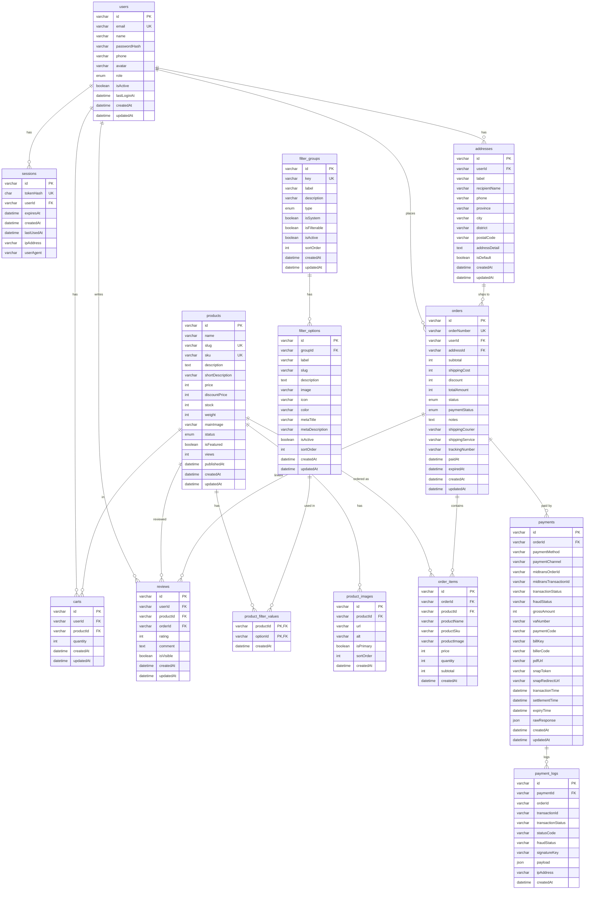

# Skema Database - Bakul Souvenir

Dokumen ini menjelaskan skema database MySQL sesuai versi DBML terbaru di
`docs/database-schema.dbml`.

- Database: MySQL 8
- Charset: `utf8mb4`
- Collation: `utf8mb4_unicode_ci`
- Semua ID bertipe `VARCHAR(191)` (CUID).
- Semua timestamp bertipe `DATETIME(3)`.
- Engine tabel: InnoDB (default MySQL, diperlukan untuk foreign key).
- `NULL` berarti kolom boleh kosong; kolom tanpa keterangan `NULL` bersifat `NOT NULL`.

Versi DBML untuk dbdiagram.io tersedia di `docs/database-schema.dbml`.

## Enum

### ProductStatus

| Nilai | Keterangan |
| --- | --- |
| `DRAFT` | Default, produk belum dipublikasikan |
| `ACTIVE` | Produk tampil di katalog publik |
| `ARCHIVED` | Produk diarsipkan |

### FilterType

| Nilai | Keterangan |
| --- | --- |
| `MULTI_SELECT` | Default, boleh pilih banyak opsi |
| `SINGLE_SELECT` | Hanya boleh satu opsi per group |

### UserRole

| Nilai | Keterangan |
| --- | --- |
| `CUSTOMER` | Default, pengguna biasa |
| `ADMIN` | Administrator |

### OrderStatus

| Nilai | Keterangan |
| --- | --- |
| `PENDING` | Default, menunggu pembayaran |
| `PAID` | Sudah dibayar |
| `PROCESSING` | Sedang diproses |
| `SHIPPED` | Sudah dikirim |
| `COMPLETED` | Selesai |
| `CANCELLED` | Dibatalkan |
| `REFUNDED` | Dikembalikan dananya |

### PaymentStatus

| Nilai | Keterangan |
| --- | --- |
| `UNPAID` | Default, belum dibayar |
| `PENDING` | Menunggu pembayaran |
| `PAID` | Sudah dibayar |
| `FAILED` | Gagal |
| `EXPIRED` | Kedaluwarsa |
| `REFUNDED` | Dikembalikan dananya |

## Tabel

### users

Tabel akun pengguna (customer dan admin).

| Kolom | Tipe | Null | Default | Keterangan |
| --- | --- | --- | --- | --- |
| id | VARCHAR(191) | NO | CUID | Primary key |
| email | VARCHAR(191) | NO | - | Unique |
| name | VARCHAR(100) | NO | - | Nama pengguna |
| passwordHash | VARCHAR(255) | NO | - | Hash password |
| phone | VARCHAR(20) | YES | NULL | Nomor telepon |
| avatar | VARCHAR(255) | YES | NULL | URL avatar |
| role | ENUM('CUSTOMER','ADMIN') | NO | CUSTOMER | Peran pengguna |
| isActive | BOOLEAN | NO | true | Status aktif |
| lastLoginAt | DATETIME(3) | YES | NULL | Waktu login terakhir |
| createdAt | DATETIME(3) | NO | CURRENT_TIMESTAMP(3) | Waktu dibuat |
| updatedAt | DATETIME(3) | NO | - | Waktu diperbarui (auto) |

Index:
- `users_email_key` UNIQUE (`email`)
- `users_role_idx` (`role`)

### sessions

Tabel session database. Menyimpan SHA-256 hash token, bukan token mentah.

| Kolom | Tipe | Null | Default | Keterangan |
| --- | --- | --- | --- | --- |
| id | VARCHAR(191) | NO | CUID | Primary key |
| tokenHash | CHAR(64) | NO | - | Unique, SHA-256 hash token |
| userId | VARCHAR(191) | NO | - | Foreign key ke `users.id` |
| expiresAt | DATETIME(3) | NO | - | Waktu kedaluwarsa |
| createdAt | DATETIME(3) | NO | CURRENT_TIMESTAMP(3) | Waktu dibuat |
| lastUsedAt | DATETIME(3) | NO | CURRENT_TIMESTAMP(3) | Waktu terakhir dipakai |
| ipAddress | VARCHAR(45) | YES | NULL | IP klien (opsional) |
| userAgent | VARCHAR(255) | YES | NULL | User agent (opsional) |

Index:
- `sessions_tokenHash_key` UNIQUE (`tokenHash`)
- `sessions_userId_idx` (`userId`)
- `sessions_expiresAt_idx` (`expiresAt`)

Foreign key:
- `sessions_userId_fkey`: `userId` -> `users(id)` ON DELETE CASCADE ON UPDATE CASCADE

### addresses

Tabel alamat pengguna.

| Kolom | Tipe | Null | Default | Keterangan |
| --- | --- | --- | --- | --- |
| id | VARCHAR(191) | NO | CUID | Primary key |
| userId | VARCHAR(191) | NO | - | Foreign key ke `users.id` |
| label | VARCHAR(50) | YES | NULL | Label alamat |
| recipientName | VARCHAR(100) | NO | - | Nama penerima |
| phone | VARCHAR(20) | NO | - | Nomor telepon |
| province | VARCHAR(100) | NO | - | Provinsi |
| city | VARCHAR(100) | NO | - | Kota |
| district | VARCHAR(100) | YES | NULL | Kecamatan |
| postalCode | VARCHAR(10) | YES | NULL | Kode pos |
| addressDetail | TEXT | NO | - | Detail alamat |
| isDefault | BOOLEAN | NO | false | Alamat default |
| createdAt | DATETIME(3) | NO | CURRENT_TIMESTAMP(3) | Waktu dibuat |
| updatedAt | DATETIME(3) | NO | - | Waktu diperbarui (auto) |

Index:
- `addresses_userId_idx` (`userId`)

Foreign key:
- `addresses_userId_fkey`: `userId` -> `users(id)` ON DELETE CASCADE ON UPDATE CASCADE

### filter_groups

Tabel group filter.

| Kolom | Tipe | Null | Default | Keterangan |
| --- | --- | --- | --- | --- |
| id | VARCHAR(191) | NO | CUID | Primary key |
| key | VARCHAR(50) | NO | - | Unique, identitas filter publik, tidak berubah setelah dibuat |
| label | VARCHAR(100) | NO | - | Label tampilan |
| description | VARCHAR(500) | YES | NULL | Deskripsi group |
| type | ENUM('MULTI_SELECT','SINGLE_SELECT') | NO | MULTI_SELECT | Tipe pilihan |
| isSystem | BOOLEAN | NO | false | Group sistem (mis. `tag`) tidak boleh dihapus |
| isFilterable | BOOLEAN | NO | true | Dapat dipakai sebagai filter |
| isActive | BOOLEAN | NO | true | Status aktif |
| sortOrder | INT | NO | 0 | Urutan tampil |
| createdAt | DATETIME(3) | NO | CURRENT_TIMESTAMP(3) | Waktu dibuat |
| updatedAt | DATETIME(3) | NO | - | Waktu diperbarui (auto) |

Index:
- `filter_groups_key_key` UNIQUE (`key`)
- `filter_groups_isActive_sortOrder_idx` (`isActive`, `sortOrder`)

Catatan: group dengan `key = "tag"` adalah filter sistem untuk tag produk.

### filter_options

Tabel opsi filter dalam satu group.

| Kolom | Tipe | Null | Default | Keterangan |
| --- | --- | --- | --- | --- |
| id | VARCHAR(191) | NO | CUID | Primary key |
| groupId | VARCHAR(191) | NO | - | Foreign key ke `filter_groups.id` |
| label | VARCHAR(100) | NO | - | Label tampilan |
| slug | VARCHAR(120) | NO | - | Slug opsi |
| description | TEXT | YES | NULL | Deskripsi opsi |
| image | VARCHAR(255) | YES | NULL | URL gambar |
| icon | VARCHAR(100) | YES | NULL | Nama ikon |
| color | VARCHAR(7) | YES | NULL | Kode warna |
| metaTitle | VARCHAR(150) | YES | NULL | Judul meta |
| metaDescription | VARCHAR(300) | YES | NULL | Deskripsi meta |
| isActive | BOOLEAN | NO | true | Status aktif |
| sortOrder | INT | NO | 0 | Urutan tampil |
| createdAt | DATETIME(3) | NO | CURRENT_TIMESTAMP(3) | Waktu dibuat |
| updatedAt | DATETIME(3) | NO | - | Waktu diperbarui (auto) |

Index:
- `filter_options_groupId_slug_key` UNIQUE (`groupId`, `slug`)
- `filter_options_groupId_isActive_sortOrder_idx` (`groupId`, `isActive`, `sortOrder`)
- `filter_options_slug_idx` (`slug`)

Foreign key:
- `filter_options_groupId_fkey`: `groupId` -> `filter_groups(id)` ON DELETE CASCADE ON UPDATE CASCADE

### product_filter_values

Tabel join produk dan opsi filter.

| Kolom | Tipe | Null | Default | Keterangan |
| --- | --- | --- | --- | --- |
| productId | VARCHAR(191) | NO | - | Foreign key ke `products.id` |
| optionId | VARCHAR(191) | NO | - | Foreign key ke `filter_options.id` |
| createdAt | DATETIME(3) | NO | CURRENT_TIMESTAMP(3) | Waktu dibuat |

Primary key: `(productId, optionId)`

Index:
- `product_filter_values_optionId_idx` (`optionId`)
- `product_filter_values_productId_idx` (`productId`)

Foreign key:
- `product_filter_values_productId_fkey`: `productId` -> `products(id)` ON DELETE CASCADE ON UPDATE CASCADE
- `product_filter_values_optionId_fkey`: `optionId` -> `filter_options(id)` ON DELETE CASCADE ON UPDATE CASCADE

### products

Tabel produk katalog.

| Kolom | Tipe | Null | Default | Keterangan |
| --- | --- | --- | --- | --- |
| id | VARCHAR(191) | NO | CUID | Primary key |
| name | VARCHAR(150) | NO | - | Nama produk |
| slug | VARCHAR(180) | NO | - | Unique, pola huruf kecil/angka/tanda hubung |
| sku | VARCHAR(50) | YES | NULL | Unique (opsional) |
| description | TEXT | NO | - | Deskripsi produk |
| shortDescription | VARCHAR(500) | YES | NULL | Deskripsi singkat |
| price | INT | NO | - | Harga Rupiah bulat tanpa desimal |
| discountPrice | INT | YES | NULL | Harga diskon |
| stock | INT | NO | 0 | Stok |
| weight | INT | NO | 0 | Berat |
| mainImage | VARCHAR(255) | YES | NULL | Gambar utama |
| status | ENUM('DRAFT','ACTIVE','ARCHIVED') | NO | DRAFT | Status produk |
| isFeatured | BOOLEAN | NO | false | Produk unggulan |
| views | INT | NO | 0 | Jumlah dilihat |
| publishedAt | DATETIME(3) | YES | NULL | Waktu publikasi |
| createdAt | DATETIME(3) | NO | CURRENT_TIMESTAMP(3) | Waktu dibuat |
| updatedAt | DATETIME(3) | NO | - | Waktu diperbarui (auto) |

Index:
- `products_slug_key` UNIQUE (`slug`)
- `products_sku_key` UNIQUE (`sku`)
- `products_status_idx` (`status`)
- `products_isFeatured_idx` (`isFeatured`)
- `products_status_createdAt_idx` (`status`, `createdAt`)

### product_images

Tabel gambar produk.

| Kolom | Tipe | Null | Default | Keterangan |
| --- | --- | --- | --- | --- |
| id | VARCHAR(191) | NO | CUID | Primary key |
| productId | VARCHAR(191) | NO | - | Foreign key ke `products.id` |
| url | VARCHAR(255) | NO | - | URL gambar |
| alt | VARCHAR(200) | YES | NULL | Teks alternatif |
| isPrimary | BOOLEAN | NO | false | Gambar utama |
| sortOrder | INT | NO | 0 | Urutan tampil |
| createdAt | DATETIME(3) | NO | CURRENT_TIMESTAMP(3) | Waktu dibuat |

Index:
- `product_images_productId_idx` (`productId`)
- `product_images_primary_idx` (`productId`, `isPrimary`)

Foreign key:
- `product_images_productId_fkey`: `productId` -> `products(id)` ON DELETE CASCADE ON UPDATE CASCADE

### carts

Tabel keranjang belanja.

| Kolom | Tipe | Null | Default | Keterangan |
| --- | --- | --- | --- | --- |
| id | VARCHAR(191) | NO | CUID | Primary key |
| userId | VARCHAR(191) | NO | - | Foreign key ke `users.id` |
| productId | VARCHAR(191) | NO | - | Foreign key ke `products.id` |
| quantity | INT | NO | 1 | Jumlah |
| createdAt | DATETIME(3) | NO | CURRENT_TIMESTAMP(3) | Waktu dibuat |
| updatedAt | DATETIME(3) | NO | - | Waktu diperbarui (auto) |

Index:
- `carts_userId_productId_key` UNIQUE (`userId`, `productId`)
- `carts_userId_idx` (`userId`)

Foreign key:
- `carts_userId_fkey`: `userId` -> `users(id)` ON DELETE CASCADE ON UPDATE CASCADE
- `carts_productId_fkey`: `productId` -> `products(id)` ON DELETE CASCADE ON UPDATE CASCADE

### orders

Tabel pesanan.

| Kolom | Tipe | Null | Default | Keterangan |
| --- | --- | --- | --- | --- |
| id | VARCHAR(191) | NO | CUID | Primary key |
| orderNumber | VARCHAR(50) | NO | - | Unique |
| userId | VARCHAR(191) | NO | - | Foreign key ke `users.id` |
| addressId | VARCHAR(191) | YES | NULL | Foreign key ke `addresses.id` |
| subtotal | INT | NO | 0 | Subtotal |
| shippingCost | INT | NO | 0 | Biaya kirim |
| discount | INT | NO | 0 | Diskon |
| totalAmount | INT | NO | 0 | Total pembayaran |
| status | ENUM('PENDING','PAID','PROCESSING','SHIPPED','COMPLETED','CANCELLED','REFUNDED') | NO | PENDING | Status pesanan |
| paymentStatus | ENUM('UNPAID','PENDING','PAID','FAILED','EXPIRED','REFUNDED') | NO | UNPAID | Status pembayaran |
| notes | TEXT | YES | NULL | Catatan |
| shippingCourier | VARCHAR(50) | YES | NULL | Kurir |
| shippingService | VARCHAR(50) | YES | NULL | Layanan kirim |
| trackingNumber | VARCHAR(100) | YES | NULL | Nomor resi |
| paidAt | DATETIME(3) | YES | NULL | Waktu dibayar |
| expiredAt | DATETIME(3) | YES | NULL | Waktu kedaluwarsa |
| createdAt | DATETIME(3) | NO | CURRENT_TIMESTAMP(3) | Waktu dibuat |
| updatedAt | DATETIME(3) | NO | - | Waktu diperbarui (auto) |

Index:
- `orders_orderNumber_key` UNIQUE (`orderNumber`)
- `orders_userId_idx` (`userId`)
- `orders_status_idx` (`status`)
- `orders_paymentStatus_idx` (`paymentStatus`)
- `orders_createdAt_idx` (`createdAt`)

Foreign key:
- `orders_userId_fkey`: `userId` -> `users(id)` ON DELETE RESTRICT ON UPDATE CASCADE
- `orders_addressId_fkey`: `addressId` -> `addresses(id)` ON DELETE SET NULL ON UPDATE CASCADE

### order_items

Tabel item pesanan.

| Kolom | Tipe | Null | Default | Keterangan |
| --- | --- | --- | --- | --- |
| id | VARCHAR(191) | NO | CUID | Primary key |
| orderId | VARCHAR(191) | NO | - | Foreign key ke `orders.id` |
| productId | VARCHAR(191) | NO | - | Foreign key ke `products.id` |
| productName | VARCHAR(150) | NO | - | Snapshot nama produk |
| productSku | VARCHAR(50) | YES | NULL | Snapshot SKU produk |
| productImage | VARCHAR(255) | YES | NULL | Snapshot gambar produk |
| price | INT | NO | - | Snapshot harga |
| quantity | INT | NO | - | Jumlah |
| subtotal | INT | NO | - | Subtotal item |
| createdAt | DATETIME(3) | NO | CURRENT_TIMESTAMP(3) | Waktu dibuat |

Index:
- `order_items_orderId_idx` (`orderId`)
- `order_items_productId_idx` (`productId`)

Foreign key:
- `order_items_orderId_fkey`: `orderId` -> `orders(id)` ON DELETE CASCADE ON UPDATE CASCADE
- `order_items_productId_fkey`: `productId` -> `products(id)` ON DELETE RESTRICT ON UPDATE CASCADE

### payments

Tabel pembayaran (Midtrans).

| Kolom | Tipe | Null | Default | Keterangan |
| --- | --- | --- | --- | --- |
| id | VARCHAR(191) | NO | CUID | Primary key |
| orderId | VARCHAR(191) | NO | - | Foreign key ke `orders.id` |
| paymentMethod | VARCHAR(50) | YES | NULL | Metode pembayaran |
| paymentChannel | VARCHAR(50) | YES | NULL | Channel pembayaran |
| midtransOrderId | VARCHAR(100) | YES | NULL | ID order Midtrans |
| midtransTransactionId | VARCHAR(100) | YES | NULL | ID transaksi Midtrans |
| transactionStatus | VARCHAR(30) | YES | NULL | Status transaksi |
| fraudStatus | VARCHAR(20) | YES | NULL | Status fraud |
| grossAmount | INT | NO | - | Jumlah bruto |
| vaNumber | VARCHAR(50) | YES | NULL | Nomor VA |
| paymentCode | VARCHAR(50) | YES | NULL | Kode pembayaran |
| billKey | VARCHAR(50) | YES | NULL | Bill key |
| billerCode | VARCHAR(50) | YES | NULL | Biller code |
| pdfUrl | VARCHAR(255) | YES | NULL | URL PDF |
| snapToken | VARCHAR(255) | YES | NULL | Token Snap |
| snapRedirectUrl | VARCHAR(255) | YES | NULL | URL redirect Snap |
| transactionTime | DATETIME(3) | YES | NULL | Waktu transaksi |
| settlementTime | DATETIME(3) | YES | NULL | Waktu settlement |
| expiryTime | DATETIME(3) | YES | NULL | Waktu kedaluwarsa |
| rawResponse | JSON | YES | NULL | Respons mentah |
| createdAt | DATETIME(3) | NO | CURRENT_TIMESTAMP(3) | Waktu dibuat |
| updatedAt | DATETIME(3) | NO | - | Waktu diperbarui (auto) |

Index:
- `payments_orderId_idx` (`orderId`)
- `payments_midtransTransactionId_idx` (`midtransTransactionId`)
- `payments_transactionStatus_idx` (`transactionStatus`)

Foreign key:
- `payments_orderId_fkey`: `orderId` -> `orders(id)` ON DELETE CASCADE ON UPDATE CASCADE

### payment_logs

Tabel log pembayaran.

| Kolom | Tipe | Null | Default | Keterangan |
| --- | --- | --- | --- | --- |
| id | VARCHAR(191) | NO | CUID | Primary key |
| paymentId | VARCHAR(191) | YES | NULL | Foreign key ke `payments.id` |
| orderId | VARCHAR(100) | YES | NULL | ID order |
| transactionId | VARCHAR(100) | YES | NULL | ID transaksi |
| transactionStatus | VARCHAR(30) | YES | NULL | Status transaksi |
| statusCode | VARCHAR(10) | YES | NULL | Kode status |
| fraudStatus | VARCHAR(20) | YES | NULL | Status fraud |
| signatureKey | VARCHAR(255) | YES | NULL | Signature key |
| payload | JSON | NO | - | Payload mentah |
| ipAddress | VARCHAR(45) | YES | NULL | IP klien |
| createdAt | DATETIME(3) | NO | CURRENT_TIMESTAMP(3) | Waktu dibuat |

Index:
- `payment_logs_orderId_idx` (`orderId`)
- `payment_logs_transactionId_idx` (`transactionId`)
- `payment_logs_createdAt_idx` (`createdAt`)

Foreign key:
- `payment_logs_paymentId_fkey`: `paymentId` -> `payments(id)` ON DELETE SET NULL ON UPDATE CASCADE

### reviews

Tabel ulasan produk.

| Kolom | Tipe | Null | Default | Keterangan |
| --- | --- | --- | --- | --- |
| id | VARCHAR(191) | NO | CUID | Primary key |
| userId | VARCHAR(191) | NO | - | Foreign key ke `users.id` |
| productId | VARCHAR(191) | NO | - | Foreign key ke `products.id` |
| orderId | VARCHAR(191) | YES | NULL | Foreign key ke `orders.id` |
| rating | INT | NO | - | Rating 1-5 |
| comment | TEXT | YES | NULL | Komentar |
| isVisible | BOOLEAN | NO | true | Tampil di publik |
| createdAt | DATETIME(3) | NO | CURRENT_TIMESTAMP(3) | Waktu dibuat |
| updatedAt | DATETIME(3) | NO | - | Waktu diperbarui (auto) |

Index:
- `reviews_userId_productId_key` UNIQUE (`userId`, `productId`)
- `reviews_productId_idx` (`productId`)
- `reviews_rating_idx` (`rating`)

Foreign key:
- `reviews_userId_fkey`: `userId` -> `users(id)` ON DELETE CASCADE ON UPDATE CASCADE
- `reviews_productId_fkey`: `productId` -> `products(id)` ON DELETE CASCADE ON UPDATE CASCADE
- `reviews_orderId_fkey`: `orderId` -> `orders(id)` ON DELETE SET NULL ON UPDATE CASCADE

## Relasi

### Auth
- `User` 1..* `Session` (hapus user menghapus session)
- `User` 1..* `Address` (hapus user menghapus alamat)

### Filter system
- `FilterGroup` 1..* `FilterOption` (hapus group menghapus opsi)
- `Product` *..* `FilterOption` melalui `product_filter_values` (hapus produk/opsi menghapus nilai filter terkait)

### Product
- `Product` 1..* `ProductImage` (hapus produk menghapus gambar)

### Cart
- `User` 1..* `Cart` (hapus user menghapus keranjang)
- `Product` 1..* `Cart` (hapus produk menghapus item keranjang)

### Orders
- `User` 1..* `Order` (hapus user dibatasi / restrict)
- `Address` 1..* `Order` (hapus alamat set null)
- `Order` 1..* `OrderItem` (hapus order menghapus item)
- `Product` 1..* `OrderItem` (hapus produk dibatasi / restrict)

### Payments
- `Order` 1..* `Payment` (hapus order menghapus pembayaran)
- `Payment` 1..* `PaymentLog` (hapus payment set null pada log)

### Reviews
- `User` 1..* `Review` (hapus user menghapus ulasan)
- `Product` 1..* `Review` (hapus produk menghapus ulasan)
- `Order` 1..* `Review` (hapus order set null)

## Catatan

- Nama tabel fisik sesuai DBML: `users`, `sessions`, `addresses`, `filter_groups`, `filter_options`, `product_filter_values`, `products`, `product_images`, `carts`, `orders`, `order_items`, `payments`, `payment_logs`, `reviews`.
- Harga selalu bilangan bulat (Rupiah), tanpa desimal atau string mata uang di database.
- Produk `DRAFT`/`ARCHIVED` tidak tampil di katalog publik.
- Opsi filter nonaktif tidak bisa dipilih baru, tetapi tetap dipertahankan jika sudah terpasang pada produk.
- Tipe `SINGLE_SELECT` hanya boleh punya satu opsi terpilih per group (validasi di Server Action).
- Menghapus group/opsi yang dipakai produk menghapus nilai filter terkait.
- Session menyimpan SHA-256 hash token, bukan token mentah.

## ERD (Mermaid)

